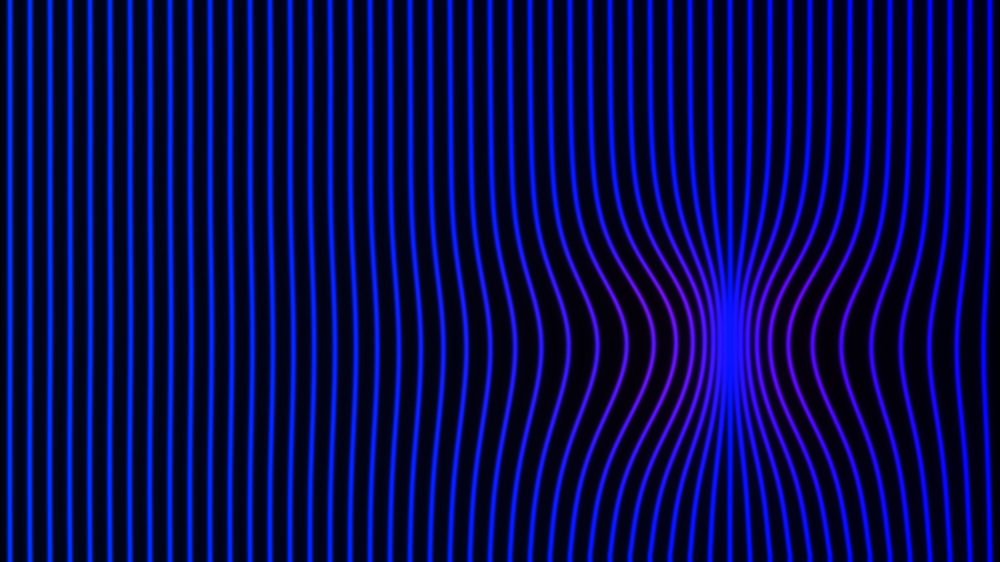
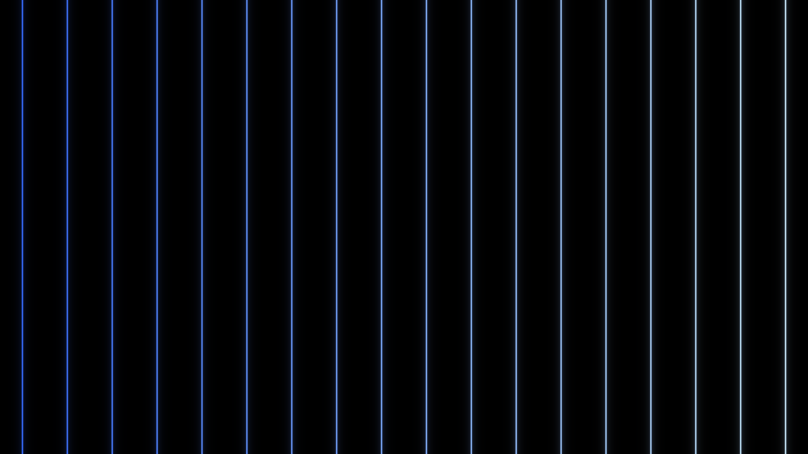
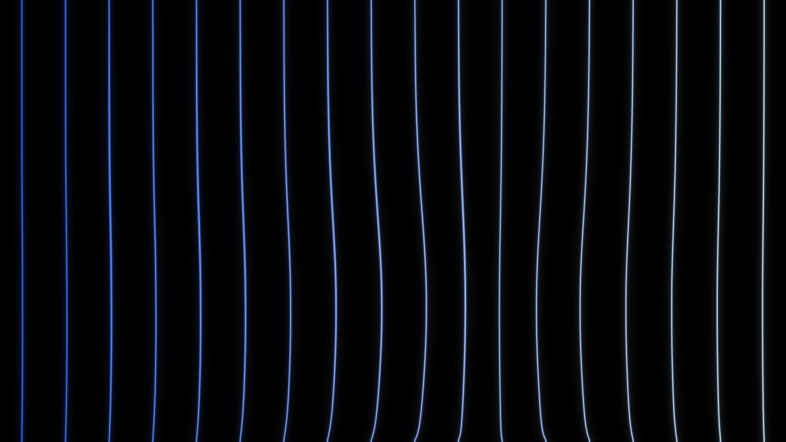
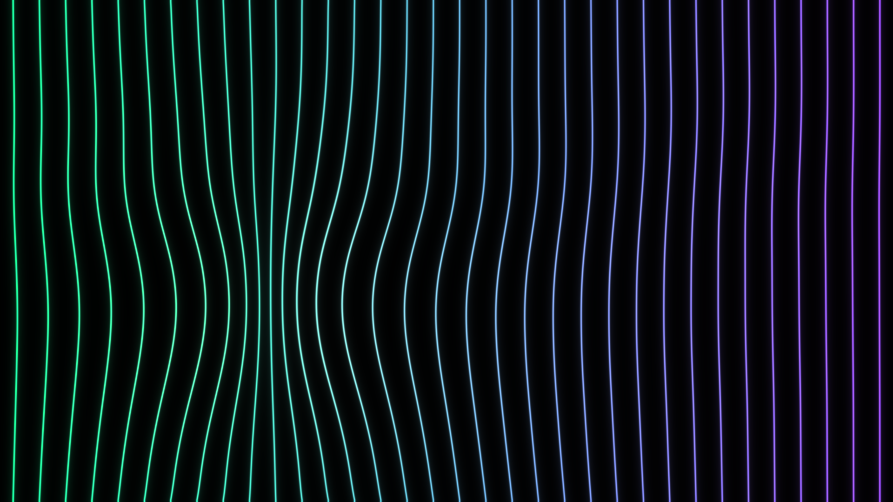

# LOOM

An interactive, audio-reactive string instrument for TouchDesigner.

Vertical elastic strings hang still across the screen. Touch or swipe them and they stretch, bend and spring back like real elastic, pulling their neighbours along in a wave. Every string is tuned to its own pitch, so a swipe across the screen plays them like a harp or a strummed guitar. The strings also listen to the room: sound picked up by the microphone makes the matching strings glow and shimmer.



| Idle | Swipe (Loom palette) | Ripple (Aurora palette) |
|---|---|---|
|  |  |  |

## Features

- **Elastic strings.** A GPU spring simulation along each string and between neighbouring strings, so a swipe drags the strings it touches and sends a wave through the rest.
- **Playable.** Each string plays a plucked note. Crossing a string plucks it, and swipe speed sets the volume, the brightness of the tone and a slight pitch bend.
- **Audio-reactive.** The microphone spectrum is read at each string's pitch, so singing or playing a note lights up the strings that match it. A noise gate keeps a quiet room perfectly still.
- **Still when idle.** With no touch and no sound, all you see are the strings.
- **One control node.** Every setting lives on `/project1/controls`.

## Requirements

- TouchDesigner 2025.32460 or newer (built and tested on Windows)
- A touchscreen or mouse
- Optional: a microphone for audio reactivity, speakers for the instrument

## Getting started

1. Clone the repo and open `Loom.toe`.
2. On first launch the project generates its plucked-string sound bank (`audio/string_bank.wav`, about 3 seconds). It is not stored in git.
3. Play on the `/project1/ui` panel with the mouse, or open the output window from the `controls` node (**Output > Open Output Window**) for fullscreen and touchscreen use.

## Controls

Select `/project1/controls` and use its parameter pages.

**Output**

| Parameter | What it does |
|---|---|
| Resolution Preset | HD, QHD, 4K, 720p, ultrawide, 32:9 LED wall, portrait, or Custom |
| Width / Height | Custom resolution (switches the preset to Custom) |
| Output Monitor | Which display the output window opens on |
| Fullscreen / Window Borders / Hide Mouse Cursor | Output window behaviour |
| Open / Close Output Window | Open or close the window |

**Strings**

| Parameter | What it does |
|---|---|
| String Count | 5 to 50 strings |
| String Thickness | 0.3 (hairline) to 8 (thick bars) |
| Palette | Loom, Ice, Aurora, Ember, Mono, or Custom |
| Color Low / High / On Touch | Gradient across the strings and the colour they flash when plucked (Custom palette) |
| Elasticity Strength | Higher is snappier and bouncier, with a longer wobble |
| Neighbor Influence | How much a string's movement drags the strings beside it |
| Touch Radius | How wide the finger's grab is |

**Sound**

| Parameter | What it does |
|---|---|
| Instrument Volume / Mute | Output level |
| Lowest Note (MIDI) | Pitch of the leftmost string (default 40, E2) |
| Range (octaves) | How far the strings spread upward |
| Scale | Major pentatonic, major, minor, Dorian, chromatic, minor pentatonic |
| Pitch Bend From Speed | How much fast swipes push the pitch sharp |

**Audio Input**

| Parameter | What it does |
|---|---|
| Audio Reactivity Sensitivity | How strongly the room's sound moves the strings |
| Noise Gate | Raise it if background noise makes idle strings move |

## How it works

- `string_sim.glsl` runs the physics on a small float texture with one column per string, stepped twice per frame through a feedback loop. Each texel stores a sideways offset and a velocity. Tension acts along the string, coupling acts between neighbouring strings, and the strings are pinned at the top and bottom.
- `string_render.glsl` draws each string from that texture with an anti-aliased core and glow. Stretched strings shift towards the touch colour, and ringing strings widen into a blurred vibrating shape.
- `instrument.py` runs every frame. It smooths the touch input, detects which strings a swipe crossed, assigns notes to a pool of 12 voices, tracks each string's vibration energy, reads the microphone spectrum and pushes everything to the shaders.
- `soundbank.py` synthesises the notes: harmonics with pluck-position shaping, slight inharmonicity and a pick transient, in soft and bright versions for MIDI 28 to 100.

The `src/` folder is a readable copy of the scripts and shaders embedded in `Loom.toe`. The `.toe` file is the source of truth.

## Project layout

```
Loom.toe                       TouchDesigner project
src/shaders/string_sim.glsl    elastic string physics
src/shaders/string_render.glsl string drawing
src/python/instrument.py       per-frame logic: touch, plucks, voices, energy
src/python/soundbank.py        plucked-string synthesis
src/python/controls_exec.py    resolution presets and output window
src/python/frame_loop.py       startup and per-frame hooks
docs/screenshots/              images used in this README
```

## Known limits

- Single touch point (one finger or mouse pointer).
- 12 voices, so fast strums across many strings cut off the oldest notes.
- With more strings than the chosen scale has notes in range, notes are paired in unisons.
- If the speakers can reach the microphone, the strings will react to their own sound. Lower the sensitivity if that is too much.
